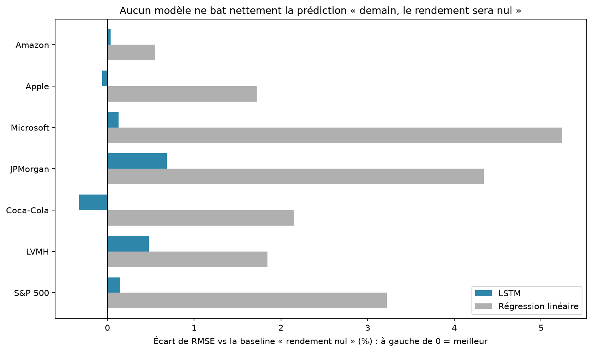

# Un LSTM peut-il prédire la Bourse mieux que « rien » ?

> **Projet pédagogique : pas un outil d'investissement.**

Parti d'un tutoriel YouTube populaire (prédiction du cours d'Apple avec un LSTM sous PyTorch), j'ai voulu vérifier ce que valait vraiment le modèle. Sa courbe de prédiction semblait presque parfaite. En la comparant à une baseline naïve, elle faisait en réalité **35 % pire que de ne rien prédire**.

Ce repo documente la démarche pour transformer ce tuto en **benchmark honnête**, puis le résultat sur 7 actifs.



## Résultat principal

Sur 7 actifs (actions US, LVMH, S&P 500), **aucun modèle ne bat nettement la prédiction « demain, le rendement sera nul »**. Le LSTM reste à moins de 0,7 % de la baseline, dans un sens ou dans l'autre. La régression linéaire fait moins bien partout.

| Actif | RMSE zéro | RMSE moyenne | RMSE linéaire | RMSE LSTM | LSTM vs zéro | Dir. toujours hausse | Dir. LSTM |
|---|---|---|---|---|---|---|---|
| Amazon (AMZN) | 0,0207 | 0,0207 | 0,0208 | 0,0207 | +0,04 % | 51,8 % | 52,1 % |
| Apple (AAPL) | 0,0153 | 0,0152 | 0,0155 | 0,0153 | −0,06 % | 54,1 % | 51,2 % |
| Microsoft (MSFT) | 0,0183 | 0,0184 | 0,0193 | 0,0184 | +0,13 % | 50,3 % | 49,4 % |
| JPMorgan (JPM) | 0,0133 | 0,0133 | 0,0139 | 0,0134 | +0,69 % | 55,6 % | 55,9 % |
| Coca-Cola (KO) | 0,0114 | 0,0113 | 0,0116 | 0,0113 | −0,33 % | 50,6 % | 50,3 % |
| LVMH (MC.PA) | 0,0186 | 0,0186 | 0,0189 | 0,0187 | +0,48 % | 46,5 % | 53,5 % |
| S&P 500 (^GSPC) | 0,0076 | 0,0076 | 0,0079 | 0,0076 | +0,15 % | 54,4 % | 52,1 % |

*Test : environ 340 séances (juillet 2025 à octobre 2026), log-rendements journaliers.*

**Le piège de LVMH.** Sa précision de direction (53,5 %) semble être la meilleure du tableau. Mais 53,5 % + 46,5 % = 100 % : le LSTM prédit simplement « baisse » tous les jours, sur une période où LVMH a surtout baissé. Ce n'est pas de la compétence, c'est la baseline « toujours baisse ».

## Ce que j'ai corrigé dans le tutoriel

| Problème dans le tuto | Conséquence | Correction |
|---|---|---|
| Aucune baseline | Une courbe « décalée d'un jour » paraît bonne | Comparaison à 3 baselines : zéro, moyenne, régression linéaire |
| Prédiction du **prix** | Série non stationnaire, le modèle extrapole mal | Prédiction des **log-rendements** |
| 200 époques sans validation | Surapprentissage : le modèle « rejoue » les chocs passés | Jeu de validation + early stopping |
| Scaler ajusté sur toute la série | Fuite de données (le modèle voit les stats du test) | Scaler ajusté sur le train seul |
| Variables écrasées dans le notebook | Résultats faux si on relance une cellule | Nouvelles variables à chaque étape |
| Saisie par `input()`, pas de date de fin | Résultats non reproductibles | Paramètres fixes + graine aléatoire |

**Effet mesuré sur Amazon :**

| Version | RMSE LSTM | RMSE zéro | Écart |
|---|---|---|---|
| Tuto (rendements, sans early stopping) | 0,0279 | 0,0207 | **+35 %** |
| Avec early stopping | 0,0207 | 0,0207 | 0 % |
| + correction de la fuite du scaler | 0,0207 | 0,0207 | 0 % |

L'early stopping supprime le surapprentissage mais ne fait apparaître aucun signal : sur tous les actifs, l'entraînement s'arrête entre l'époque 20 et 62, autrement dit la meilleure version est presque toujours un modèle quasi constant. La fuite du scaler était réelle mais sans effet sur la conclusion. Je l'ai vérifié au lieu de le supposer.

## Interprétation

Ces résultats sont cohérents avec l'**hypothèse d'efficience des marchés** : à l'horizon d'une journée, les rendements passés ne contiennent presque pas d'information exploitable sur le rendement du lendemain. Un modèle plus complexe n'y change rien. Il apprend du bruit, sauf si on l'en empêche, et dans ce cas il converge vers une simple moyenne.

## Limites

- Une seule variable en entrée (le rendement passé) : pas de volume, d'indicateurs techniques ni de données externes.
- Une seule période de test, sans validation glissante (walk-forward).
- Pas de test statistique formel des écarts : l'incertitude d'un taux de direction sur ~340 jours est d'environ ±5 points.

## Reproduire

```bash
git clone https://github.com/<nsellal>/FinancePred.git
cd FinancePred
python3 -m venv venv
source venv/bin/activate
pip install -r requirements.txt
jupyter lab
```

Ouvrir `financePred.ipynb`, puis *Kernel → Restart Kernel and Run All Cells*.

## Structure

```
FinancePred/
├── benchmark.py            # pipeline complet, réutilisable sur n'importe quel ticker
├── financePred.ipynb       # démarche pas à pas + benchmark sur 7 actifs
├── reports/figures/        # graphiques
└── requirements.txt        # versions exactes des bibliothèques
```

## Stack

Python · PyTorch · scikit-learn · pandas · NumPy · yfinance · Matplotlib

## Auteur

**Nassim Sellal** : étudiant en Mastère Big Data & IA (Sup de Vinci Bordeaux) et en Master Intelligence Économique, à la recherche d'une alternance Data Analyst / Data Engineer / Data Scientist.

[LinkedIn](https://www.linkedin.com/in/nassim-sellal-28ba8a2b4/)

*Tutoriel d'origine : NeuralNine, « Stock Price Prediction in Python with PyTorch ».*
